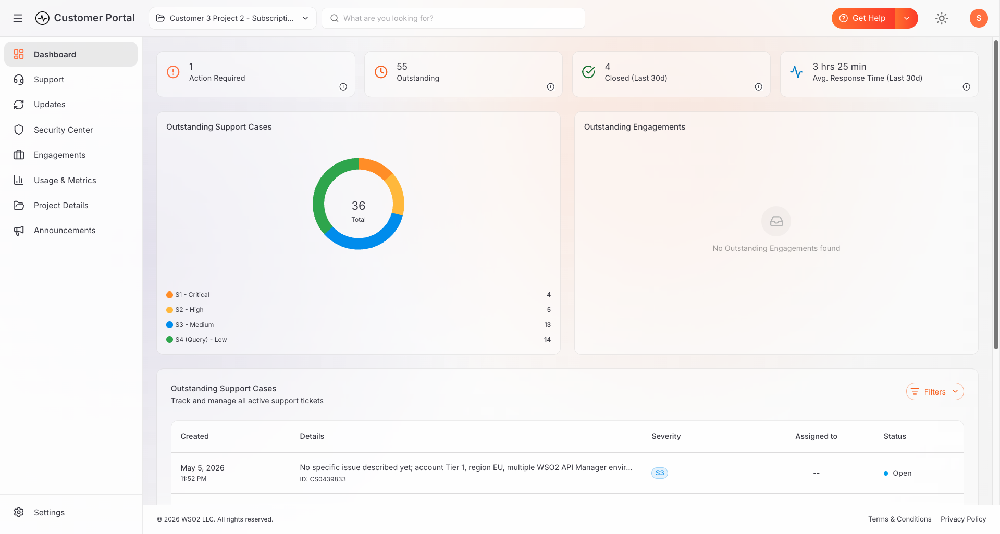
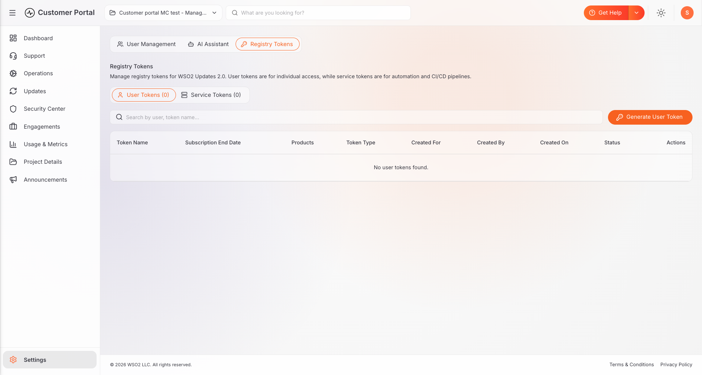

# Overview

This comprehensive guide is designed for Choreo Labs customers and their administrators, providing essential instructions on managing registry tokens within the Choreo Labs Support Portal to retrieve updated Choreo Labs product images via the Command Line Interface (CLI).

To access this feature, navigate to the **Settings > Registry Tokens** page in the Choreo Labs Customer Portal.  

